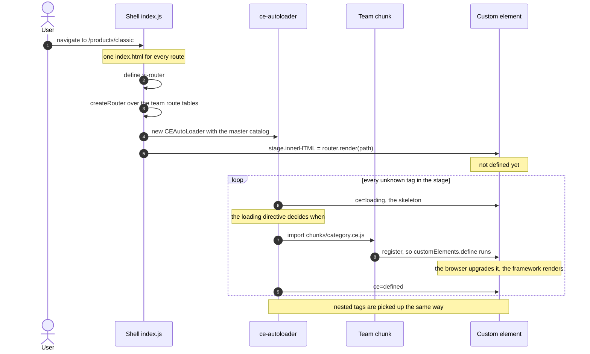
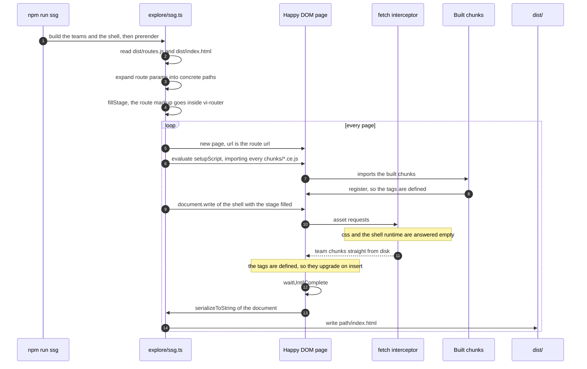

# Micro-Frontends Store Example

Tractor Micro-Frontends (MFE) example with lazy loaded web-components, using ce-autoloader, preact, svelte and vue.

The objective is to have a large site with hundreds of components on multiple frontend frameworks while
generating lean pages and components that can talk to each other between boundaries.

Without manual hard-coded imports, without complex build-step tooling(module federation)

## Architecture

- Each team ([checkout](./checkout/), [decide](./decide/) and [explore](./explore/)) has an isolated repository.
- Each team can choose their frontend technology stack, as long as they export web-components.
- Each team can use another team component inside their projects without importing/linking them before-hand.
  - Teams can mock components for local isolated development.

- Each team publishes a bunch of files, independently of one another:
  - A [routing file](./checkout/routes.ts)
  - A web-components [catalog](./checkout/catalog.ts)
  - Several compiled [web-components files](./checkout/components/minicart.ce.svelte) and its assets.

- A shell glues/bundles them together:
  - A [router](./src/router.ts) reads each routing table
  - A [Master catalog](./src/catalog.ts) joins each team catalog together
  - Support for dynamic-sites(server side), where the components and pages are be updated real-time.
  - Support for static-sites(local), the components and pages are updated after the build step.

- WebComponents not used on the page are not downloaded!
- WebComponents are lazy-loaded, with proper loading animation (skeleton screens)
- Errors in components are contained:
  - A single bad component wont break the site compilation and runtime.
- Inner components , since they're only consumable by their own team.
- State is shared between team boundaries via `signals` or other native browser features (`localStorage`)

## Running the site

```bash
npm install
npm run dev
```

Open `http://localhost:5173` in your browser.

| Command               | What it does                                                       |
| --------------------- | ------------------------------------------------------------------ |
| `npm run dev`         | Dev server (source modules, hot reload) on `http://localhost:5173` |
| `npm run ssg`         | Build the teams and the shell, then prerender the pages            |
| `npm run preview`     | Serve the built output on `http://localhost:4173`                  |
| `npm run preview:ssg` | `npm run ssg` followed by `npm run preview`                        |

`npm run dev` always renders the SPA. To look at the prerendered output, build it and serve it:

```bash
npm run preview:ssg
```

## Rendering modes

Both modes load the same components, from the same catalogs, with the same lazy loading.
The only difference is **when the page markup is produced**. For the longer story - what each
mode costs, what bit us building this, and where the trade-offs landed - see
[POST-MORTEM.md](./POST-MORTEM.md).

|                           | SPA mode                                                      | SSG mode                               |
| ------------------------- | ------------------------------------------------------------- | -------------------------------------- |
| Markup is rendered        | in the browser, on every navigation                           | at build time, once per page           |
| Page html                 | an empty stage: `<vi-router class="tractor-app"></vi-router>` | the components already expanded        |
| Components are loaded by  | ce-autoloader, in the browser                                 | ce-autoloader, in the browser          |
| Stylesheets are linked by | the preload helper, with the chunk                            | the prerender, from the build manifest |
| Good for                  | development                                                   | crawlers and first paint               |
| Run with                  | `npm run dev`                                                 | `npm run ssg` + `npm run preview`      |

### SPA mode

The shell is the only html document. It boots a [router](./src/router.ts) over the team
route tables, renders the matched route into `<vi-router>`, and lets
[ce-autoloader](./src/app.ts) discover the custom elements in that markup and lazy-load
them. The markup only exists once the JavaScript has run, which is why this mode is for
development rather than for crawlers.

Links stay ordinary links, so a navigation is a document navigation: the server answers with
the same shell and the router renders the route for the new url. That is what the
cross-document view transitions in [index.html](./index.html) are set up for.



`npm run dev` always runs this mode: it serves source modules, never the build output.

### SSG mode

[`explore/ssg.ts`](./explore/ssg.ts) walks the same route tables, and for every concrete
route renders the page into the built shell html and writes the result to disk:

```
<vi-router class="tractor-app"></vi-router>

    -> <vi-router class="tractor-app"><explore-pages-home><main>…</main></explore-pages-home></vi-router>
```

The expansion is done by [Happy DOM's ServerRenderer](https://github.com/capricorn86/happy-dom/wiki/Server-Renderer):
it loads the **built** team components - the very chunks the browser loads - lets them
upgrade and render, and serializes the resulting document. No browser and no hand written
templates, so the files can not drift from the app.



```bash
npm run ssg
```

```
[ssg] explore: rendering 4 routes
[ssg] + /stores -> dist/stores/index.html (4.9 kB, 4 css)
[ssg] + /products -> dist/products/index.html (14.6 kB, 4 css)
[ssg] + /products/classic -> dist/products/classic/index.html (10.9 kB, 4 css)
[ssg] + /products/autonomous -> dist/products/autonomous/index.html (7.6 kB, 4 css)
[ssg] + / -> dist/index.html (6.3 kB, 5 css)
[ssg] done, 5 pages written to dist
```

Pages are written next to the shell build, path for path, so a static server can serve them
as they are: `/products/classic` is `dist/products/classic/index.html`.

#### Which routes are prerendered

Only the routes of the teams that have an SSG pass. Today that is [explore](./explore/),
whose four routes expand to five pages - the `:category` param is enumerated from the team
database:

| Route                 | File                                                                      |
| --------------------- | ------------------------------------------------------------------------- |
| `/`                   | `dist/index.html`                                                         |
| `/products`           | `dist/products/index.html`                                                |
| `/products/:category` | `dist/products/classic/index.html`, `dist/products/autonomous/index.html` |
| `/stores`             | `dist/stores/index.html`                                                  |

The [decide](./decide/) (`/product/:id`) and [checkout](./checkout/) (`/checkout/cart`, …)
routes are not prerendered yet. They are served the shell and rendered in the browser.

#### Serving the built site

`npm run preview` serves `dist/` the way a static host has to, so both kinds of page work:

```
try_files $uri $uri/index.html /index.html
```

- a prerendered page is served for its directory (`/products` -> `products/index.html`)
- any other route gets the shell, so it can render client-side (`/product/AU-03`)

`vite preview` on its own does not do the first one, which is why `/products` - the url the
navigation actually links to - needs this.

#### Notes

- `npm run build` empties `dist/`, so the prerender has to run after it. `npm run ssg` does
  both. `npm run preview` warns when `dist/` has no prerendered page.
- The shell build consumes the published team catalogs and routes, so the teams have to be
  built first (`npm run build --workspaces`). `npm run ssg` builds them for you.
- The components upgrade in place: the loader finds the tags the pass left in the document and
  defines them, so the markup the pass wrote stays and the live DOM is built inside it.
- A prerendered page carries `data-prerendered="/the/route"` on `<html>`. The shell reads it
  and leaves the stage alone, rather than rendering the same route over the markup. The router
  still ships, because a prerendered page links to routes no pass prerenders - the decide and
  checkout pages - and those are rendered in the browser.
- `npm test -w explore` runs the component tests, which render the built components in
  [Happy DOM](./explore/test/happy-dom-env.ts) - the same way the SSG pass does.
- `SSG_DEBUG=1 npm run ssg` logs every asset the render asks for, which is the quickest way
  to see what a page is missing.

### Stylesheets

A component's stylesheet is fetched by the bundler's preload helper, which **waits for it**
before defining the element. In SPA mode that is enough on its own: a component never renders
before its styles are there, so nothing is painted unstyled.

SSG breaks that guarantee. The markup is in the document from the first byte, while the
stylesheet would only arrive with the javascript - so the page paints unstyled, then restyles
once the css lands. On `/products/classic` the product list paints as a plain vertical stack
and only becomes the two column grid afterwards.

So the prerender links the stylesheets of every component it expanded. The mapping comes from
the builds themselves: each one writes a Vite manifest (`manifest: true`) naming the
stylesheet every module was compiled into, and a module becomes a tag the way the team's own
`catalog.ts` names it - `pages/category.ce.tsx` in the `explore` build is
`<explore-pages-category>`. See [component-styles.ts](./src/component-styles.ts).

| Prerendered page      | Stylesheets linked                               |
| --------------------- | ------------------------------------------------ |
| `/`                   | header, footer, recommendations, home, mini-cart |
| `/products`           | header, footer, category, mini-cart              |
| `/products/:category` | header, footer, category, mini-cart              |
| `/stores`             | header, footer, stores, mini-cart                |

The links go at the end of `<head>`, after the shell's own stylesheet, so a team's component
styles win - the same order the browser ends up with when it appends them while loading
components lazily.

The block carries a `<!-- component styles -->` marker, and that marker is load bearing. The
pass writes the root page over the shell html, so on a rerun its input is its own output: the
marker is what lets it drop the block a previous run added, instead of stacking a second copy
and leaking the root page's stylesheets into every other page.

This is only about styles that are *already in the document*. Everything the browser still
loads lazily keeps the SPA guarantee, because the preload helper fetches a component's css
before it defines the element. The mini-cart's placeholder is in the prerendered markup, so
its stylesheet is linked; `<ds-button>`, which the mini-cart only renders once it is upgraded,
is fetched with its chunk and simply is not there yet.

Two guards keep this from rotting silently: the prerender **throws** when a page uses a tag
that names a build but that no build declares (a build that did not run, a renamed
convention), and warns when a component's build declares no stylesheet at all. A tag outside
every namespace - `<vi-router>`, a third party element - is somebody else's business and is
left alone.

## Preview a single team

In your terminal, enter the team folder and run `npm run dev`.

Only [explore](./explore/) ships a playground, on `http://localhost:4002`, where you can
preview its components in isolation.

## Building and publishing

To publish a single team work, run `npm run build` inside the team folder (eg: [explore](./explore/))

## Known gaps

- **Per-route head tags.** Every prerendered page carries the shell's single `<title>`. There
  are no per-route titles, descriptions, canonicals or structured data yet.
- **Only explore is prerendered.** The decide and checkout routes are still rendered in the
  browser, so they are the pages a crawler sees as an empty stage.
- **The mini-cart pops in.** It belongs to the checkout team, so an explore pass leaves its
  placeholder and the browser fills it later. Its stylesheet is linked and its box is
  reserved, so the shift is contained rather than gone.
- **Cold-cache font swap.** Raleway is `font-display: swap`, so a first visit with an empty
  cache reflows the text once the font lands (~0.001 CLS).
