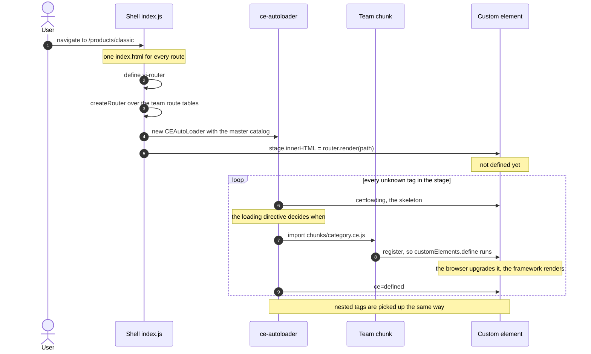
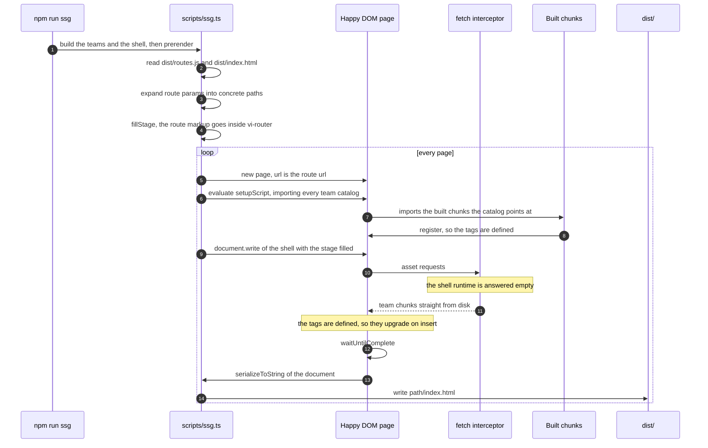

# Micro-Frontends Store Example

Tractor Micro-Frontends (MFE) example with lazy loaded web-components, using ce-autoloader, preact, svelte and vue.

The objective is to have a large site with hundreds of components on multiple frontend frameworks while
generating lean pages and components that can talk to each other between boundaries.

Without manual hard-coded imports, without complex build-step tooling(module federation)

## Architecture

- Each team ([checkout](./checkout/), [decide](./decide/) and [explore](./explore/)) has an isolated repository.
- Each team can choose their frontend technology stack, as long as they export web-components.
- Each team can use another team component inside their projects without importing/linking them before-hand.
  - Teams can mock components for local isolated development.

- Each team publishes a bunch of files, independently of one another:
  - A [routing file](./checkout/routes.ts)
  - A web-components [catalog](./checkout/catalog.ts)
  - Several compiled [web-components files](./checkout/components/minicart.ce.svelte) and its assets.

- A shell glues/bundles them together:
  - A [router](./src/router.ts) reads each routing table
  - A [Master catalog](./src/catalog.ts) joins each team catalog together
  - Support for dynamic-sites(server side), where the components and pages are be updated real-time.
  - Support for static-sites(local), the components and pages are updated after the build step.

- WebComponents not used on the page are not downloaded!
- WebComponents are lazy-loaded, with proper loading animation (skeleton screens)
- Errors in components are contained:
  - A single bad component wont break the site compilation and runtime.
- Inner components , since they're only consumable by their own team.
- State is shared between team boundaries via `signals` or other native browser features (`localStorage`)

## Running the site

```bash
npm install
npm run dev
```

Open `http://localhost:5173` in your browser.

| Command               | What it does                                                       |
| --------------------- | ------------------------------------------------------------------ |
| `npm run dev`         | Dev server (source modules, hot reload) on `http://localhost:5173` |
| `npm run ssg`         | Build the teams and the shell, then prerender the pages            |
| `npm run preview`     | Serve the built output on `http://localhost:4173`                  |
| `npm run preview:ssg` | `npm run ssg` followed by `npm run preview`                        |

`npm run dev` always renders the SPA. To look at the prerendered output, build it and serve it:

```bash
npm run preview:ssg
```

## Rendering modes

Both modes load the same components, from the same catalogs, with the same lazy loading.
The only difference is **when the page markup is produced**. For the longer story - what each
mode costs, what bit us building this, and where the trade-offs landed - see
[POST-MORTEM.md](./POST-MORTEM.md).

|                           | SPA mode                                                      | SSG mode                               |
| ------------------------- | ------------------------------------------------------------- | -------------------------------------- |
| Markup is rendered        | in the browser, on every navigation                           | at build time, once per page           |
| Page html                 | an empty stage: `<vi-router class="tractor-app"></vi-router>` | the components already expanded        |
| Components are loaded by  | ce-autoloader, in the browser                                 | ce-autoloader, in the browser          |
| Stylesheets are linked by | the preload helper, with the chunk                            | the prerender, from the build manifest |
| Good for                  | development                                                   | crawlers and first paint               |
| Run with                  | `npm run dev`                                                 | `npm run ssg` + `npm run preview`      |

### Which mode am I looking at?

A ribbon in the bottom right corner says it: black **SPA** when the shell rendered the route in
the browser, coral **SSG** when the page was served prerendered and the shell left the markup
alone. It follows what you are looking at, not what a build was configured to do: on a built site
a route that no pass covers is a page the browser rendered, and it says so. So does
`/checkout/thanks` reached by placing an order - that navigation happens in the browser, through
`router.navigate` - while the same url typed into the address bar arrives prerendered.

The shell is the only thing that knows, so [`src/ribbon.ts`](./src/ribbon.ts) is mounted from
[`src/app.ts`](./src/app.ts), outside the stage, so re-rendering a route cannot take it with it.
The prerender registers the catalogs but never runs the shell's own bootstrap, which is why the
ribbon is in none of the files the pass writes.

### SPA mode

The shell is the only html document. It boots a [router](./src/router.ts) over the team
route tables, renders the matched route into `<vi-router>`, and lets
[ce-autoloader](./src/app.ts) discover the custom elements in that markup and lazy-load
them. The markup only exists once the JavaScript has run, which is why this mode is for
development rather than for crawlers.

Links stay ordinary links, so a navigation is a document navigation: the server answers with
the same shell and the router renders the route for the new url. That is what the
cross-document view transitions in [index.html](./index.html) are set up for.



`npm run dev` always runs this mode: it serves source modules, never the build output.

### SSG mode

[`scripts/ssg.ts`](./scripts/ssg.ts) walks the same route tables, and for every concrete
route renders the page into the built shell html and writes the result to disk:

```
<vi-router class="tractor-app"></vi-router>

    -> <vi-router class="tractor-app"><explore-pages-home><main>…</main></explore-pages-home></vi-router>
```

The expansion is done by [Happy DOM's ServerRenderer](https://github.com/capricorn86/happy-dom/wiki/Server-Renderer):
it loads the **built** team components - the very chunks the browser loads - lets them
upgrade and render, and serializes the resulting document. No browser and no hand written
templates, so the files can not drift from the app.



```bash
npm run ssg
```

```
[ssg] prerendering explore, decide, checkout
[ssg] + / -> dist/index.html (7.7 kB, 4 css)
[ssg] + /products -> dist/products/index.html (14.9 kB, 5 css)
[ssg] + /products/classic -> dist/products/classic/index.html (11.1 kB, 5 css)
[ssg] + /stores -> dist/stores/index.html (5.2 kB, 4 css)
[ssg] + /product/AU-01 -> dist/product/AU-01/index.html (8.8 kB, 8 css)
[ssg] + /checkout/cart -> dist/checkout/cart/index.html (7.2 kB, 5 css)
…
[ssg] done, 31 pages written to dist
```

Pages are written next to the shell build, path for path, so a static server can serve them
as they are: `/products/classic` is `dist/products/classic/index.html`.

#### Which routes are prerendered

Every team that has a built route table, which today is all three. A team's routes are read
from its `dist/routes.js` and a `:param` is enumerated from its own database:

| Team                        | Route                 | Files                                                                     |
| --------------------------- | --------------------- | ------------------------------------------------------------------------- |
| [explore](./explore/)       | `/`                   | `dist/index.html`                                                         |
|                             | `/products`           | `dist/products/index.html`                                                |
|                             | `/products/:category` | `dist/products/classic/index.html`, `dist/products/autonomous/index.html` |
|                             | `/stores`             | `dist/stores/index.html`                                                  |
| [decide](./decide/)         | `/product/:id`        | `dist/product/<id>/index.html`, one per product                           |
| [checkout](./checkout/)     | `/checkout/cart`      | `dist/checkout/cart/index.html`                                           |
|                             | `/checkout/checkout`  | `dist/checkout/checkout/index.html`                                       |
|                             | `/checkout/thanks`    | `dist/checkout/thanks/index.html`                                         |

A page uses components from more than one team - a checkout page uses explore's header, a
decide page uses checkout's add to cart - so the render loads every team's catalog. That is
free: the stylesheet index narrows the result back down per page.

#### Serving the built site

`npm run preview` serves `dist/` the way a static host has to, so both kinds of page work:

```
try_files $uri $uri/index.html /index.html
```

- a prerendered page is served for its directory (`/products` -> `products/index.html`)
- any other route gets the shell, so it can render client-side (`/product/AU-03`)

`vite preview` on its own does not do the first one, which is why `/products` - the url the
navigation actually links to - needs this.

#### Notes

- `npm run build` empties `dist/`, so the prerender has to run after it. `npm run ssg` does
  both. `npm run preview` warns when `dist/` has no prerendered page.
- The shell build consumes the published team catalogs and routes, so the teams have to be
  built first (`npm run build --workspaces`). `npm run ssg` builds them for you.
- The components upgrade the tags the pass left in the document, so the first paint is the
  prerendered markup. Preact and Vue replace it as they mount; Svelte mounts by *appending*, so
  the checkout team's custom elements clear their host first (`adoptPrerenderedMarkup`) - without
  that, a prerendered page would show the build-time render and then the live one underneath it.
- A prerendered page carries `data-prerendered="/the/route"` on `<html>`. The shell reads it
  and leaves the stage alone, rather than rendering the same route over the markup. The router
  still ships: a prerendered page links to routes no pass prerenders, and those are rendered in
  the browser.
- `npm test -w explore` runs the component tests, which render the built components in
  [Happy DOM](./explore/test/happy-dom-env.ts) - the same way the SSG pass does.
- `CE_RENDER_TRACE=1 npm run ssg` logs every asset the render asks for, and `SSG_TRACE=1`
  traces what it is waiting for. Between them, a page that renders wrong is usually obvious.
- `--team <name>` narrows a run to one team (`npm run ssg -w explore`). A full run is the one
  to use: the pass reads the shell html, and a narrowed run may be reading a page a previous
  pass wrote over it.

### Rendering without a browser

[`scripts/ce-render.ts`](./scripts/ce-render.ts) is the machinery behind the pass, on its own:
give it html, a build manifest and a catalog, and it returns the html with the custom elements
expanded and their stylesheets linked.

```ts
const html = await ceRenderToString(
  "<explore-pages-home></explore-pages-home>",
  manifest, // explore/dist/.vite/manifest.json
  catalog, // explore/dist/catalog.js
  { catalogUrl: "/explore/dist/catalog.js", roots: [process.cwd()] },
);
```

That is what a server answering with html needs - the markup is already rendered when it
reaches the browser, instead of a shell that fills itself in later. It is also what the SSG
pass is built on, and what its tests use to render a single component in isolation.

Three things have to be rewritten for a render to work at all, and all three are
happy-dom limitations rather than anything about the app:

| What                                                | Why                                                                                                          |
| --------------------------------------------------- | ------------------------------------------------------------------------------------------------------------ |
| `import Default,{named}from"…"`                     | happy-dom's compiler rewrites imports with a regex that needs `import` + whitespace/`{`, so this is left half rewritten and the module never parses |
| `import.meta.resolve ? … : …`                        | happy-dom can not compile it, and a module that fails to compile does not throw - the render waits for an import that never resolves, until it times out |
| the preload helper wrapping every catalog loader     | it fetches the component's stylesheet and **waits for it**; a render links styles from the manifest, and a `<link>` it never asked for only delays the components past serialization |

Only the render sees the rewritten modules - the files on disk are untouched. See
`renderable()` in [ce-render.ts](./scripts/ce-render.ts).

### Stylesheets

A component's stylesheet is fetched by the bundler's preload helper, which **waits for it**
before defining the element. In SPA mode that is enough on its own: a component never renders
before its styles are there, so nothing is painted unstyled.

SSG breaks that guarantee. The markup is in the document from the first byte, while the
stylesheet would only arrive with the javascript - so the page paints unstyled, then restyles
once the css lands. On `/products/classic` the product list paints as a plain vertical stack
and only becomes the two column grid afterwards.

So the prerender links the stylesheets of every component it expanded. The mapping comes from
the builds themselves: each one writes a Vite manifest (`manifest: true`) naming the
stylesheet every module was compiled into, and a module becomes a tag the way the team's own
`catalog.ts` names it - `pages/category.ce.tsx` in the `explore` build is
`<explore-pages-category>`. See [component-styles.ts](./scripts/component-styles.ts).

For the explore pages that comes out as:

| Prerendered page      | Stylesheets linked                               |
| --------------------- | ------------------------------------------------ |
| `/`                   | header, footer, recommendations, home, mini-cart |
| `/products`           | header, footer, category, mini-cart              |
| `/products/:category` | header, footer, category, mini-cart              |
| `/stores`             | header, footer, stores, mini-cart                |

The links go at the end of `<head>`, after the shell's own stylesheet, so a team's component
styles win - the same order the browser ends up with when it appends them while loading
components lazily.

The block carries a `<!-- component styles -->` marker, and that marker is load bearing. The
pass writes the root page over the shell html, so on a rerun its input is its own output: the
marker is what lets it drop the block a previous run added, instead of stacking a second copy
and leaking the root page's stylesheets into every other page.

This is only about styles that are *already in the document*. Everything the browser still
loads lazily keeps the SPA guarantee, because the preload helper fetches a component's css
before it defines the element. The mini-cart's placeholder is in the prerendered markup, so
its stylesheet is linked; `<ds-button>`, which the mini-cart only renders once it is upgraded,
is fetched with its chunk and simply is not there yet.

Two guards keep this from rotting silently: the prerender **throws** when a page uses a tag
that names a build but that no build declares (a build that did not run, a renamed
convention), and warns when a component's build declares no stylesheet at all. A tag outside
every namespace - `<vi-router>`, a third party element - is somebody else's business and is
left alone.

## Testing

Every team has its own runner, and they are run from the team folder:

```
cd checkout && npm test
```

The script builds the team, then renders **every page it publishes** through
[`ceRenderToString`](./scripts/ce-render.ts) - the very function the SSG renders with, over the
same built catalog and build manifest. That is the assertion worth making: a page that renders
here is a page that renders at build time. The pages come from the *built catalog* rather than a
list, so a page added to `pages/` is covered the moment it is built, and one that stops
rendering fails here, naming itself, instead of at build time.

That contract lives in one place, [`scripts/team-render.ts`](./scripts/team-render.ts): a team's
[`test/render.ts`](./checkout/test/render.ts) is one line binding the *preset* for its build, and
its [`test/pages.test.ts`](./checkout/test/pages.test.ts) hands that preset to `describePages`.
Every team's pages are held to the same two properties, so a page that renders once for checkout
renders once for decide, and the tests that prove it cannot drift apart. The teams come from the
SSG's own table ([`scripts/ssg-teams.ts`](./scripts/ssg-teams.ts)), which is why a team added
there is a team the pass writes pages for *and* a team the suite renders.

The second property is that a page renders **once**, even when it arrives with the markup a
prerendered page carries. Svelte mounts by *appending*, so without `adoptPrerenderedMarkup` a
prerendered checkout page showed the build-time render with the live one underneath - Preact and
Vue replace on their own. Take the `extend` off a checkout element and that test fails, which is
the whole point of it.

The page tests sit next to the pages they test, the way
[explore's](./explore/pages/home.ce.test.ts) do. There is no `happy-dom-env.ts` to import:
`ceRenderToString` runs a Happy DOM ServerRenderer, which brings its own window, so a global one
would only shadow it. [Explore's](./explore/test/happy-dom-env.ts) is for the component tests
that mount by hand.

| team                    | run it with               | covers                                                          |
| ----------------------- | ------------------------- | --------------------------------------------------------------- |
| [explore](./explore/)   | `cd explore && npm test`  | its components mounted, its pages rendered, the shell's modules |
| [checkout](./checkout/) | `cd checkout && npm test` | its pages, rendered through the SSG's own renderer              |
| [decide](./decide/)     | `cd decide && npm test`   | its pages, rendered through the SSG's own renderer              |

`npm test` at the root runs all three.

## Preview a single team

In your terminal, enter the team folder and run `npm run dev`.

Only [explore](./explore/) ships a playground, on `http://localhost:4002`, where you can
preview its components in isolation.

## Building and publishing

To publish a single team work, run `npm run build` inside the team folder (eg: [explore](./explore/))

## Known gaps

- **Per-route head tags.** Every prerendered page carries the shell's single `<title>`. There
  are no per-route titles, descriptions, canonicals or structured data yet.
- **The mini-cart pops in.** It belongs to the checkout team, so a page of any other team
  leaves its placeholder and the browser fills it later. Its stylesheet is linked and its box
  is reserved, so the shift is contained rather than gone.
- **Cold-cache font swap.** Raleway is `font-display: swap`, so a first visit with an empty
  cache reflows the text once the font lands (~0.001 CLS).
